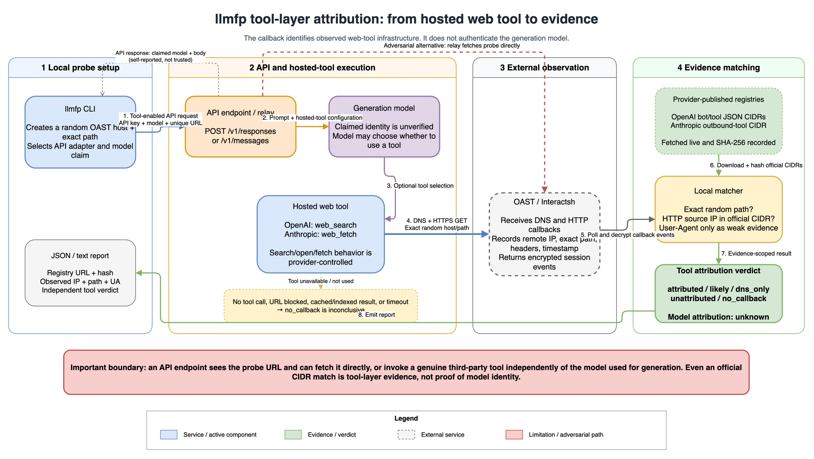

# llmfp

[](https://github.com/toads/llmfp/actions/workflows/ci.yml)
[](LICENSE)

`llmfp` attributes the infrastructure that executes a web fetch for an LLM API.
It creates a one-time `oast.pro` URL, asks the API to open it with a hosted web
tool, observes DNS/HTTP callbacks, and compares the HTTP source IP against
provider-published CIDR registries.

It deliberately reports model identity as unknown. A genuine provider web tool
does not prove that the same provider generated the final model response.

This is an independent research tool. It is not affiliated with, endorsed by,
or sponsored by OpenAI, Anthropic, or ProjectDiscovery.

### Scope at a glance

| Signal | Current conclusion | Not established |
|---|---|---|
| Exact callback from a provider-published CIDR | Web-tool infrastructure attribution | Generation-model identity |
| User-Agent match only | Weak, forgeable supporting evidence | Provider attribution |
| API-reported model name | Unverified endpoint claim | Model authenticity |
| No callback | Inconclusive result | That a relay is fake |

Read [the evidence model](docs/EVIDENCE.md) before using results in an audit or
public claim. Planned behavioral fingerprints and contribution opportunities
are tracked in [TODO.md](TODO.md).

## How tool-layer attribution works



The normal evidence path is shown in blue, grey, and green. The dashed red path
is an important adversarial alternative: because the API endpoint sees the
unique probe URL, a relay can fetch it directly or invoke a genuine hosted tool
independently of the model used to generate its answer.

Download the editable [Draw.io source](docs/architecture/llmfp-tool-attribution.drawio),
the [editable high-resolution PNG](docs/images/llmfp-tool-attribution.drawio.png),
or the [SVG export](docs/images/llmfp-tool-attribution.svg).

## Install

Download a published release archive from the [releases
page](https://github.com/toads/llmfp/releases), or install from source:

```bash
go install github.com/toads/llmfp/cmd/llmfp@latest
```

## Quick start

```bash
go build -o llmfp ./cmd/llmfp

export RELAY_API_KEY='replace-me'
./llmfp test --base-url https://relay.example --model claimed-model-name
```

`llmfp` automatically checks `LLMFP_API_KEY` and then `RELAY_API_KEY`. It uses
`OPENAI_API_KEY` automatically only when the target host is `api.openai.com`,
and `ANTHROPIC_API_KEY` only when the target is `api.anthropic.com`, so an
official key is not accidentally sent to a relay.

## Build

Go 1.25.12 or newer is required. This minimum includes the standard-library
security fixes used by the release CI.

```bash
go build -o llmfp ./cmd/llmfp
```

## Test a relay

Pass either the API origin, the base URL ending in `/v1`, or the complete
adapter endpoint. `llmfp` normalizes all three forms.

For OpenAI Responses:

```text
https://relay.example              -> https://relay.example/v1/responses
https://relay.example/v1           -> https://relay.example/v1/responses
https://relay.example/v1/responses -> unchanged
```

For Anthropic Messages:

```text
https://api.anthropic.com             -> https://api.anthropic.com/v1/messages
https://relay.example/v1              -> https://relay.example/v1/messages
https://relay.example/v1/messages     -> unchanged
```

```bash
export RELAY_API_KEY='replace-me'

./llmfp test \
  --base-url https://relay.example/v1 \
  --model claimed-model-name \
  --api-key-env RELAY_API_KEY
```

Progress is written to stderr. Use `--quiet` to suppress it, or `--json` for a
versioned machine-readable report on stdout.

Frequently reused values can be set without a config file:

```bash
export LLMFP_BASE_URL=https://relay.example/v1
export LLMFP_MODEL=claimed-model-name
export LLMFP_API_KEY=replace-me

./llmfp test
```

For machine-readable output:

```bash
./llmfp test \
  --base-url https://relay.example/v1 \
  --model claimed-model-name \
  --api-key-env RELAY_API_KEY \
  --json
```

If neither `--api-key-env` nor `--api-key-stdin` is supplied, an interactive
terminal prompts for the key without echoing it. Do not put API keys directly
on the command line, where shell history and process listings may expose them.

## API adapters

`--adapter auto` is the default. It selects `anthropic-messages` for
`api.anthropic.com` or a `claude-*` model name; otherwise it selects
`openai-responses`. Override it when a relay uses aliases that hide the upstream
protocol:

```bash
./llmfp test \
  --adapter anthropic-messages \
  --base-url https://relay.example/v1 \
  --model relay-claude-alias
```

The OpenAI adapter sends:

```json
{
  "model": "claimed-model-name",
  "tools": [{"type": "web_search"}],
  "input": "Open the unique probe URL and return its body"
}
```

The Anthropic adapter calls `/v1/messages` with `x-api-key`,
`anthropic-version: 2023-06-01`, and the broadly compatible basic server tool:

```json
{
  "model": "claude-model-name",
  "max_tokens": 1024,
  "messages": [{"role": "user", "content": "Fetch the unique probe URL"}],
  "tools": [{
    "type": "web_fetch_20250910",
    "name": "web_fetch",
    "max_uses": 1
  }]
}
```

APIs that only emulate `/v1/chat/completions` or do not expose hosted web tools
cannot be classified by this adapter. A missing callback is inconclusive; it
does not by itself prove that a relay or model is fake.

## Evidence registries

At test time, `llmfp` downloads and hashes these official registries:

- `https://openai.com/chatgpt-user.json`
- `https://openai.com/searchbot.json`
- `https://openai.com/gptbot.json`
- `https://platform.claude.com/docs/en/api/ip-addresses.md`

Anthropic publishes `160.79.104.0/21` for outbound tool calls including web
search and web fetch. The reported surface is therefore `outbound-tools`; the
CIDR alone does not distinguish one Anthropic server tool from another.

An official CIDR match is primary evidence. A matching User-Agent without a
CIDR match is only weak evidence because headers are forgeable.

## Diagnostics

Check public probe registration and all official registry downloads without an
API key:

```bash
./llmfp doctor
./llmfp doctor --json
```

## Result statuses

- `attributed`: HTTP source IP matched a downloaded provider registry.
- `likely`: only forgeable supporting evidence, such as User-Agent, matched.
- `dns_only`: name resolution occurred but no HTTP fetch was observed.
- `unattributed`: HTTP fetch occurred but no official CIDR matched.
- `no_callback`: no callback was observed before the timeout.

`no_callback` is inconclusive. The API may ignore tools, lack hosted web search,
or block public probe domains.

## Machine-readable contract

JSON reports contain `"schema_version": "1"`. Fields in schema version 1 will
not be removed or change meaning in a patch release. New optional fields may be
added. Consumers should preserve unknown enum values instead of treating them
as errors.

Exit codes are intentionally about whether the test ran, not whether a provider
was attributed:

- `0`: the command completed and produced a report, including inconclusive
  results such as `no_callback` or `unattributed`.
- `1`: invalid arguments, registration/API/runtime failure before a report,
  failed diagnostics, or output failure.

Use `tool_attribution.status` for the result; do not infer it from the process
exit code.

## Privacy and trust

The API key stays in the local CLI, but it is sent to the host selected by
`--base-url`. The public `oast.pro` service can observe callback metadata. Never
put secrets in probe URLs or prompts; use a self-hosted Interactsh server for
sensitive testing. See [SECURITY.md](SECURITY.md).

The API endpoint sees the unique probe URL and can fetch it directly. Therefore
an exact path proves correlation with the test, not that the claimed model chose
or executed the tool. Full interpretation and adversary assumptions are in
[docs/EVIDENCE.md](docs/EVIDENCE.md).

## Development

```bash
make check
make integration  # explicitly uses public network services
```

Release archives for Linux, macOS, and Windows are configured through
GoReleaser. CI intentionally keeps public-network integration tests out of the
default test suite.

## License

Project source code and documentation are licensed under Apache-2.0. You may
use, modify, and redistribute them subject to that license, including its notice
and patent terms. Contributions are accepted under the same license. See
[LICENSE](LICENSE), [NOTICE](NOTICE), and
[THIRD_PARTY_NOTICES.md](THIRD_PARTY_NOTICES.md).

External papers and datasets keep their own licenses. In particular, the
planned Zenodo behavioral-fingerprint dataset is CC-BY-4.0 and is not currently
bundled or relicensed as Apache-2.0.
